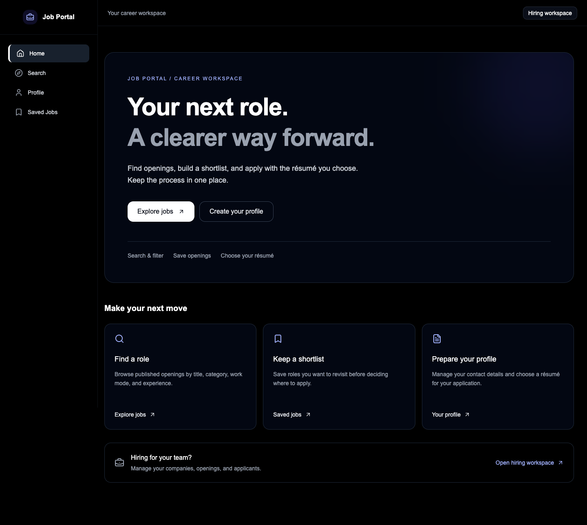
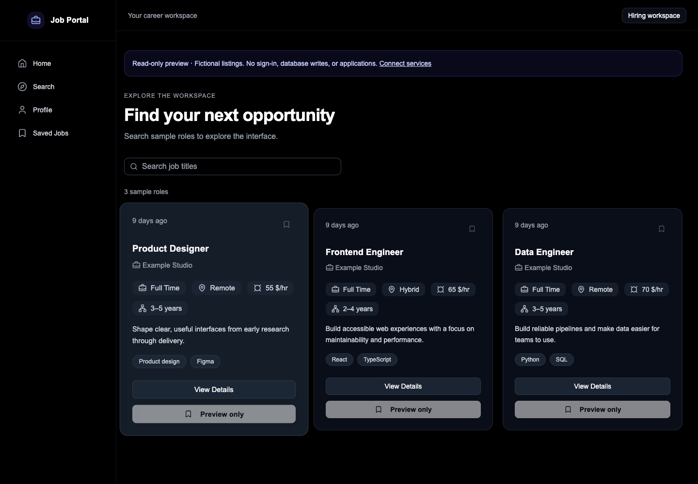
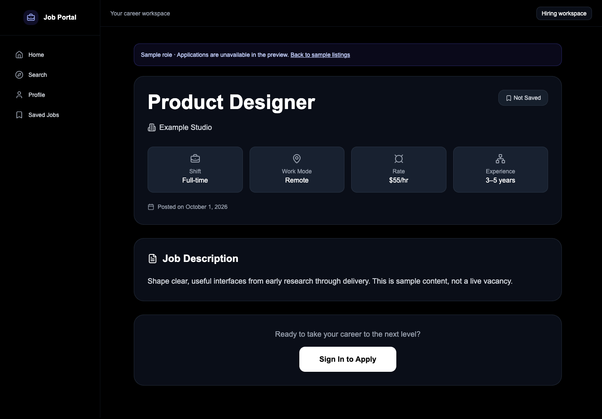
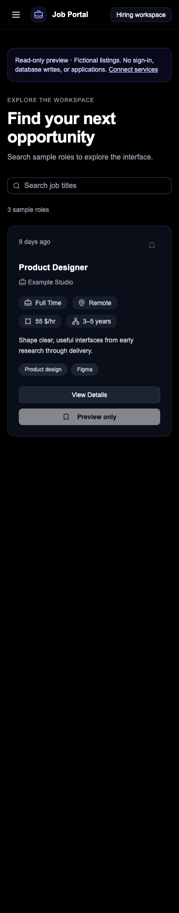

# Job Portal

A career workspace for browsing roles, saving a shortlist, and managing applications. Employers can maintain company profiles, publish openings, and review applicants.

Built by [Nikhil Yarra](https://github.com/nymav) with Next.js, React, TypeScript, Clerk, Prisma, and MongoDB.



## Explore locally

**Node.js 22 or newer** is required.

```sh
git clone https://github.com/nymav/nymav-job-portal.git
cd nymav-job-portal
npm ci
npm run dev
```

Open [localhost:3000](http://localhost:3000). With no service credentials, the home page and **`/preview`** run in read-only mode. Sample roles are fictional; search and detail views work, while sign-in, saving, and applications require the connected services. Unconfigured API routes reject writes.

## The workspace

| For candidates | For employers |
| --- | --- |
| Search published roles and filter by category, work mode, experience, shift, and date | Create and edit owned company profiles and job listings |
| Save roles and revisit a shortlist | Publish and unpublish openings |
| Maintain contact details and résumé links | Review applicants for owned jobs |
| Apply with a chosen résumé | Retain the résumé link and contact email selected at submission |

AI-assisted text generation and application emails are optional integrations. The app does not perform AI candidate ranking or automated hiring decisions.

### Listings



### Role details



<details>
<summary>Mobile preview</summary>



</details>

These screenshots show the current interface using the service-free preview, not a live hiring database.

## Connect services

Copy the configuration template:

```sh
cp .env.example .env.local
```

| Variable | Purpose |
| --- | --- |
| `DATABASE_URL` | MongoDB connection string; use a replica set, such as MongoDB Atlas, for Prisma transactions |
| `NEXT_PUBLIC_CLERK_PUBLISHABLE_KEY` | Clerk’s public application key |
| `CLERK_SECRET_KEY` | Clerk’s server key |
| `GEMINI_API_KEY` / `GEMINI_MODEL` | Optional Google Gemini text generation; choose a model available to your account |
| `SMTP_EMAIL` / `SMTP_PASSWORD` | Optional Gmail SMTP confirmations; use an app password |

Keep secrets in `.env.local` or your hosting provider’s environment settings. Never use a `NEXT_PUBLIC_` prefix for a secret.

Apply the schema and seed categories against a **development database**:

```sh
npm run db:push
npm run seed
npm run dev
```

The seed command adds missing categories and can be rerun. It does not create user accounts or fictional job listings. Schema changes add optional résumé and contact fields to application records; older applications retain their existing data.

Authentication protects the candidate profile, saved jobs, employer workspace, and APIs. Employer access is based on ownership: any signed-in user can create listings and manage their own records. The `/admin` route name does not imply a platform-wide administrator role.

## Data and integrations

- Clerk handles authentication. MongoDB stores profiles, jobs, companies, résumé links, saved roles, and application records.
- Résumés are linked through HTTPS URLs; this application does not provide a file-upload storage service. Applicants should use a link intended for employers to access.
- AI requests run on the server. Generating text sends the prompt to Google; manual editing works without an AI key.
- Optional email confirmations use the signed-in account’s verified primary email. Email failure does not undo a recorded application.

This is a connected web application, not a local-only document tool.

## Validation

```sh
npm run lint
npm run type-check
npm test
npm run build
npm start
```

GitHub Actions runs these checks on pushes and pull requests. Regression tests cover editable-field restrictions, invalid record IDs, and safe résumé URLs. The preview has been checked for title search, preserved URL filters, detail navigation, mobile overflow, and blocked writes without configuration.

The production dependency audit reports no known vulnerabilities. Five advisories remain in development-only globbing dependencies used by ESLint; `npm audit fix --force` would downgrade Next.js lint tooling and is not applied.

Live Clerk sign-in, MongoDB transactions, email delivery, and model responses require configured accounts and have not been validated in the service-free preview.

## Deploy

Deploy to a host that supports a Next.js server runtime, such as Vercel, or run the production build on your own Node.js server. Set the required environment variables and configure Clerk’s production domain before connecting users.

**GitHub Pages cannot run this full application:** authentication, APIs, and database operations require a server.

## Repository map

```text
app/          Pages, layouts, and API handlers
components/   Shared interface components
lib/          Database client, input schemas, mail, and preview fixtures
prisma/       MongoDB schema
scripts/      Category seed and server-side AI generation
tests/        Input-validation regressions
docs/images/  Current interface screenshots
```
