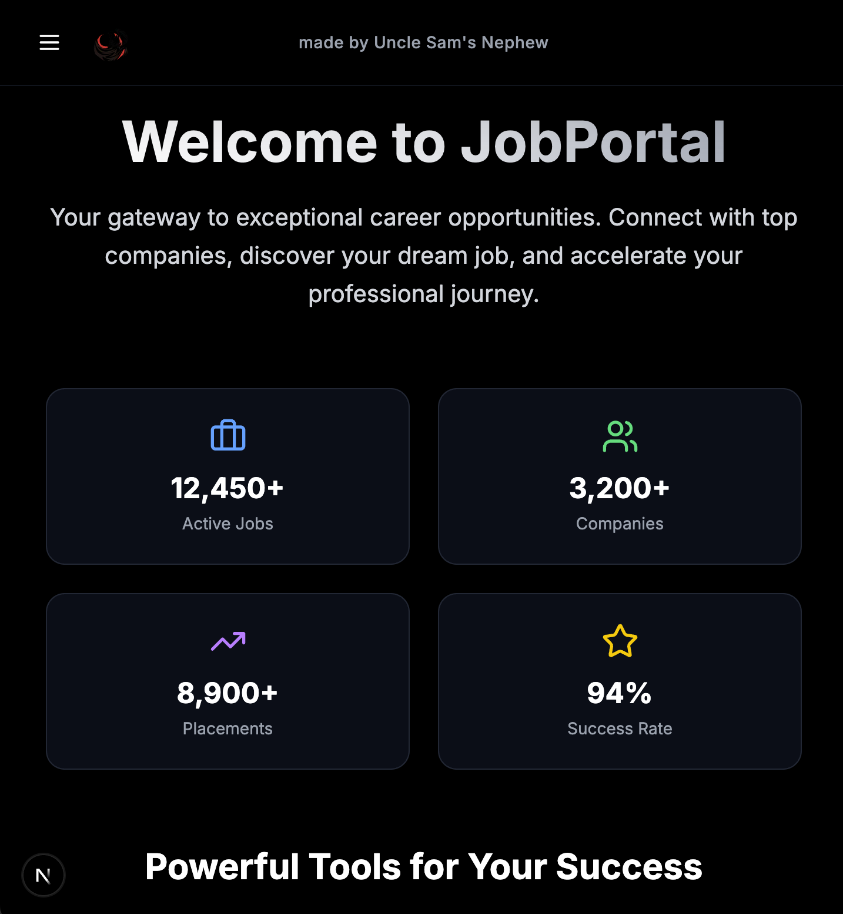
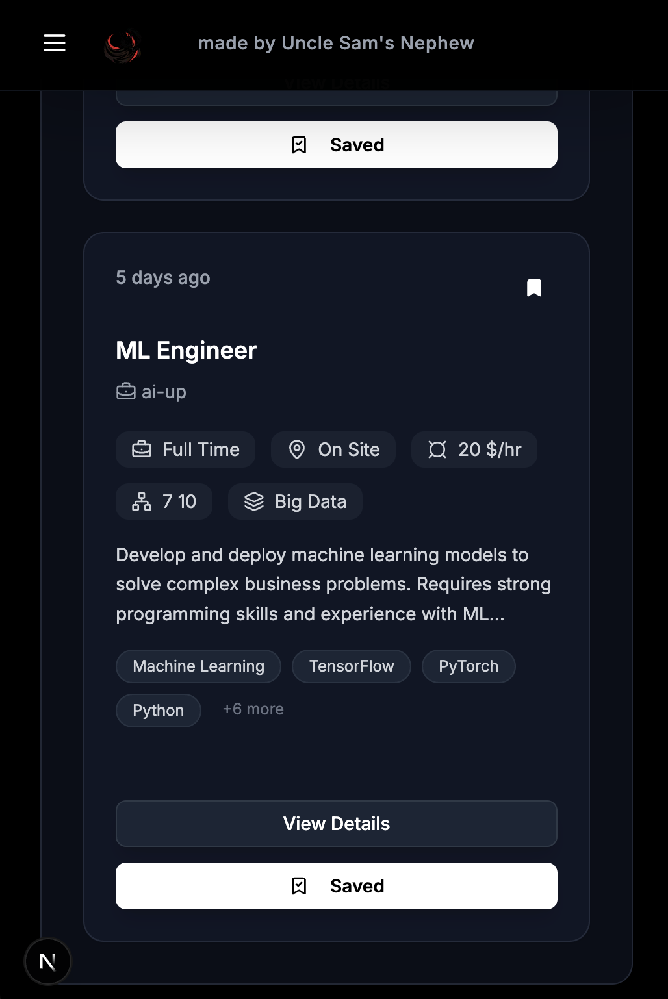

# Job Portal

A Next.js job-portal starter with job search, filtering, user accounts, company profiles, and application-management interfaces.

Built with TypeScript, Clerk, Prisma, MongoDB, Tailwind CSS, and Radix UI. The repository also includes integrations for generated content and email.

## Interface




## Local setup

The application requires a MongoDB connection and a Clerk application. Configure any optional integrations before using the features that depend on them.

```sh
git clone https://github.com/nymav/nymav-job-portal.git
cd nymav-job-portal
npm install
```

Create `.env.local` with your database and Clerk configuration:

```env
DATABASE_URL="your_mongodb_connection_string"
NEXT_PUBLIC_CLERK_PUBLISHABLE_KEY="your_clerk_publishable_key"
CLERK_SECRET_KEY="your_clerk_secret_key"
NEXT_PUBLIC_CLERK_SIGN_IN_URL="/sign-in"
NEXT_PUBLIC_CLERK_SIGN_UP_URL="/sign-up"
```

Review the Prisma schema and connect a development database, then run:

```sh
npm run prisma:generate
npx prisma db push
npm run dev
```

Open http://localhost:3000. The optional `npm run seed` command populates the configured database; review `scripts/seeds.ts` before running it.

## Build

```sh
npm run type-check
npm run build
npm start
```

## Project structure

- `app/` — pages, layouts, and routes.
- `actions/` — server-side operations.
- `components/` — shared interface components.
- `prisma/schema.prisma` — database models.
- `scripts/seeds.ts` — development seed data.

## Status

This is a starter project. Before a public deployment, validate authentication, permissions, database access, and the integrations you enable. It requires a server runtime and external services; GitHub Pages cannot host the full application.
